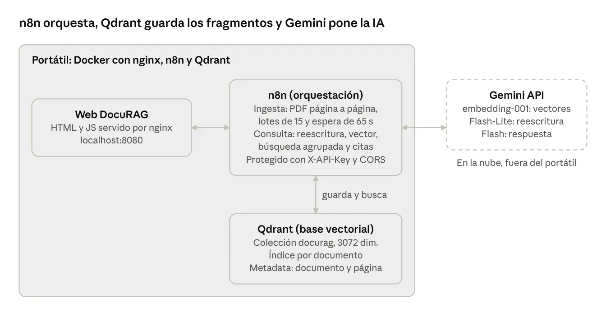
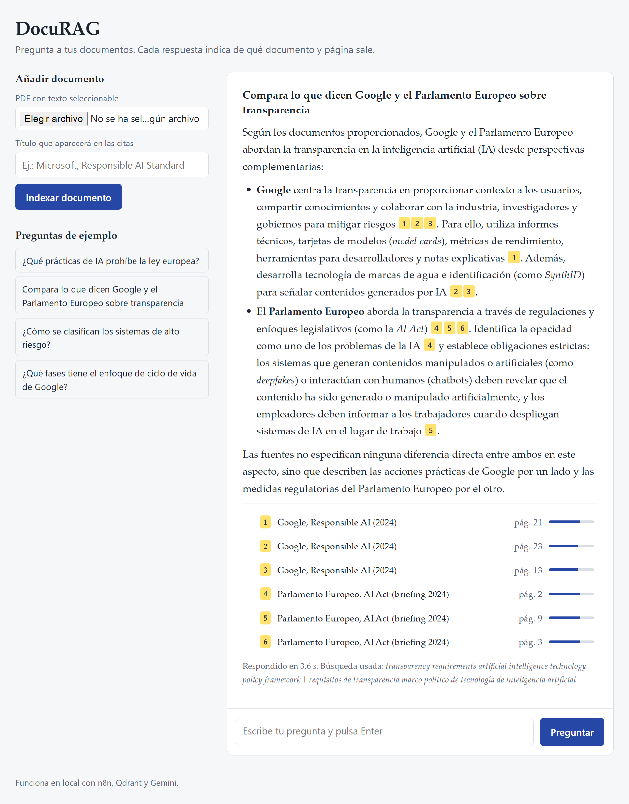
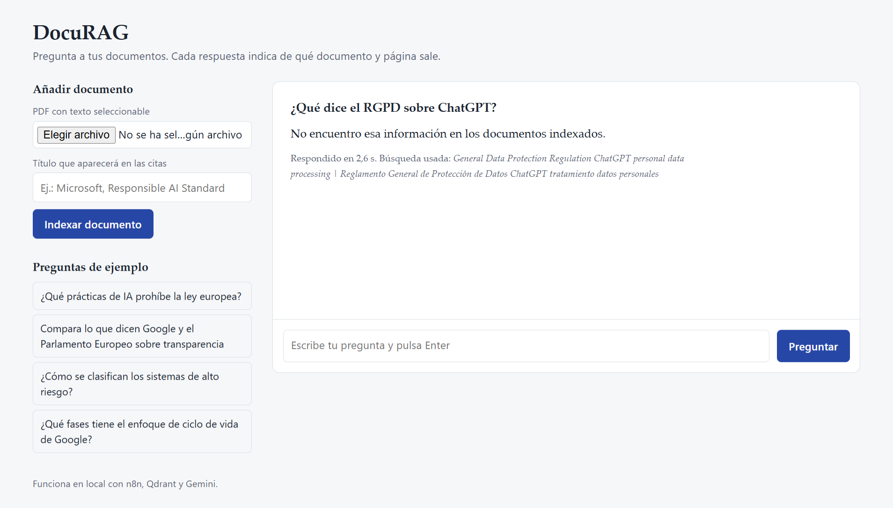
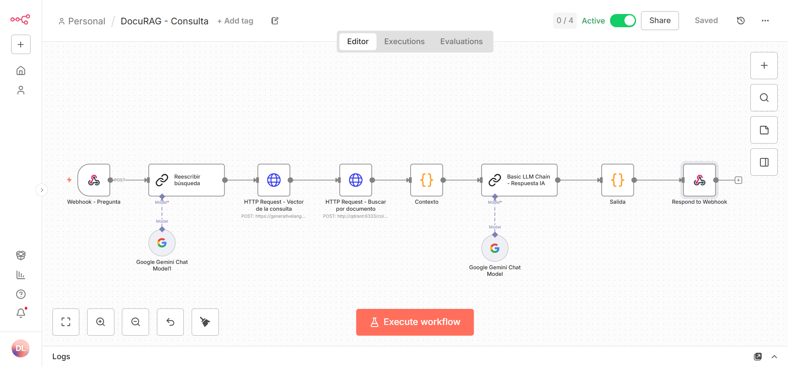

# DocuRAG

Prototipo para hacer preguntas sobre documentos PDF largos y obtener respuestas citadas por documento y página. Si la información no está en los documentos, lo indica en lugar de inventarla.

Las preguntas pueden hacerse en español aunque los documentos estén en inglés.



## Qué hace
## Capturas

Comparación entre documentos: las citas en amarillo enlazan con la fuente (documento y página).



Si la respuesta no está en los documentos, lo dice en lugar de inventarla.



Flujo de consulta en n8n: reescritura, vector, búsqueda agrupada, contexto, respuesta y citas.



Flujo de ingesta en n8n: PDF página a página, lotes de 15 y espera para respetar la cuota.


- **Ingesta:** sube un PDF con su título. Se extrae el texto página a página, se descartan las páginas sin contenido (portadas, separadores), se divide en fragmentos y se guarda en Qdrant con el documento y la página como metadata.
- **Consulta:** la pregunta se reescribe en inglés y español con los conceptos clave, se busca agrupando por documento y Gemini responde solo con los fragmentos encontrados, citando cada afirmación.
- **Web:** subida de documentos y chat con las citas resaltadas. Al pulsar una cita se marca su fuente.

## Stack

| Pieza | Uso |
|---|---|
| n8n | Orquestación de los flujos de ingesta y consulta |
| Qdrant (Docker) | Base de datos vectorial, colección de 3072 dimensiones con índice por documento |
| Gemini API | `gemini-embedding-001` para los vectores, Flash-Lite para reescribir la búsqueda y Flash para la respuesta |
| nginx (Docker) | Sirve la web |
| HTML y JavaScript | Interfaz, sin dependencias externas |

## Flujos de n8n

**Ingesta** (`flujos/ingesta.json`)

Webhook → Extract from File (PDF, páginas separadas) → Code (una entrada por página, filtra páginas de menos de 200 caracteres) → Loop Over Items (lotes de 15 páginas) → Qdrant Vector Store (embeddings Gemini, fragmentos de 3000 caracteres con solapamiento de 400) → Wait 65 s

Los lotes y la espera mantienen el envío por debajo del límite de 30.000 tokens por minuto del nivel gratuito de Gemini.

**Consulta** (`flujos/consulta.json`)

Webhook → Reescribir búsqueda (Gemini Flash-Lite) → Vector de la consulta (Gemini embeddings) → Búsqueda agrupada en Qdrant (hasta 5 documentos, 3 fragmentos por documento) → Contexto → Respuesta (Gemini Flash) → Salida (solo las fuentes citadas)

## Decisiones técnicas

- **Embeddings en la nube y no en local.** Con Ollama en un portátil sin GPU, indexar un documento de unas 140 páginas tardó más de 22 minutos sin terminar. El flujo está pensado para que, en un servidor con GPU, el modelo de embeddings se sustituya por uno local.
- **Búsqueda agrupada por documento.** El RGPD (187 fragmentos) acaparaba los resultados y las preguntas que comparaban documentos fallaban. Subir el número de resultados era un parche; la búsqueda agrupada de Qdrant garantiza fragmentos de cada documento.
- **Reescritura de la consulta.** Las preguntas comparativas buscaban por nombres de organizaciones en lugar de por el tema. Un paso previo convierte la pregunta en conceptos clave en inglés y español, y desarrolla siglas como RGPD.
- **Un modelo distinto para cada paso.** Cada modelo de Gemini tiene su propia cuota; separar reescritura y respuesta reparte el consumo.
- **Validación con preguntas de control.** Cada cambio se comprueba con una batería fija, incluida una pregunta trampa cuya respuesta no está en los documentos.

## Seguridad

- Webhooks protegidos con cabecera `X-API-Key` (Header Auth en n8n) y CORS limitado al origen de la web.
- Qdrant y la web solo escuchan en `127.0.0.1`.
- La clave de la web es para una demo local. En producción se sustituiría por login de usuarios con la clave guardada en el servidor.

## Puesta en marcha

Requisitos: Docker Desktop, n8n en Docker y una clave de Gemini API.

```powershell
docker network create docurag
docker run -d --name qdrant --network docurag --restart unless-stopped -p 127.0.0.1:6333:6333 -v qdrant_data:/qdrant/storage qdrant/qdrant
docker network connect docurag NOMBRE_CONTENEDOR_N8N
```

Crear la colección y el índice:

```powershell
Invoke-RestMethod -Method Put -Uri http://localhost:6333/collections/docurag -ContentType 'application/json' -Body '{"vectors":{"size":3072,"distance":"Cosine"}}'
Invoke-RestMethod -Method Put -Uri http://localhost:6333/collections/docurag/index -ContentType 'application/json' -Body '{"field_name":"metadata.documento","field_schema":"keyword"}'
```

En n8n: importar los dos flujos de `flujos/`, crear las credenciales (Qdrant, Gemini, Header Auth) y activarlos.

Web:

```powershell
docker run -d --name docurag-web --restart unless-stopped -p 127.0.0.1:8080:80 -v C:\docurag\web:/usr/share/nginx/html:ro nginx:alpine
```

Poner la clave en `API_KEY` dentro de `web/index.html` y abrir `http://localhost:8080`.

## Documentos de prueba

- Reglamento General de Protección de Datos (UE) 2016/679, español
- European Parliament Research Service, briefing sobre el AI Act, inglés
- Google, AI Responsibility 2024 update, inglés
- Microsoft Responsible AI Standard v2, inglés

Los PDF no se incluyen en el repositorio; se pueden descargar de sus fuentes oficiales.

## Límites conocidos y siguientes pasos

- PDF escaneados: necesitan OCR.
- Tablas dentro de los PDF: el texto extraído pierde su estructura.
- Documentos muy grandes: procesar por partes para resúmenes o extracciones completas.
- Extracción estructurada: convertir un documento en una tabla (plazos, importes, obligaciones) con su página de origen.
- Modelos locales con GPU para datos sensibles.
- Login de usuarios y permisos por documento.
